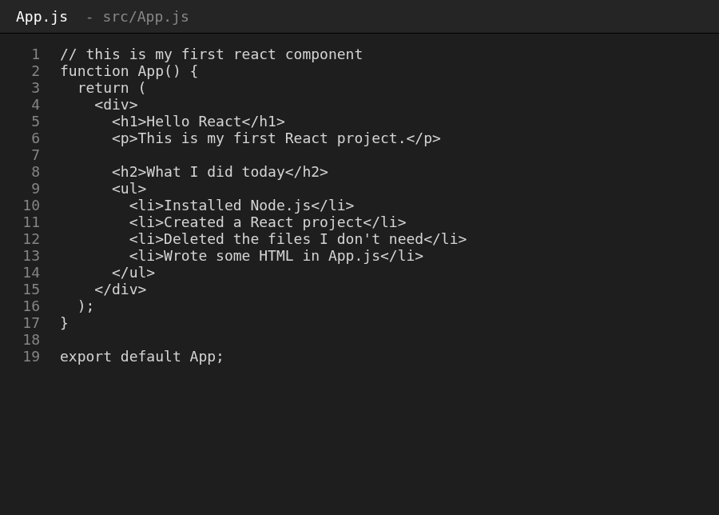
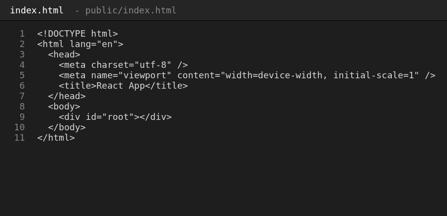
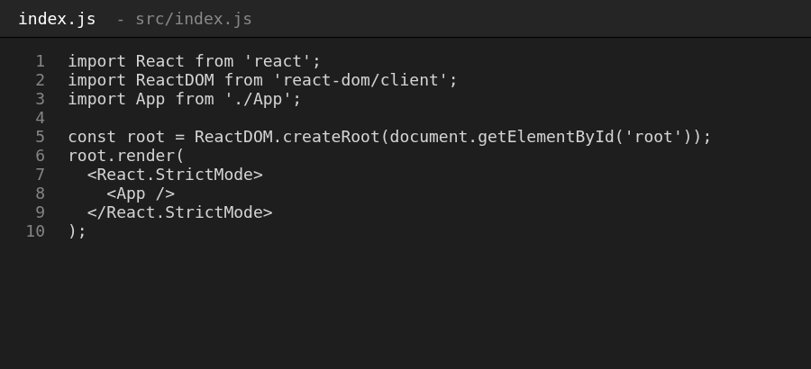
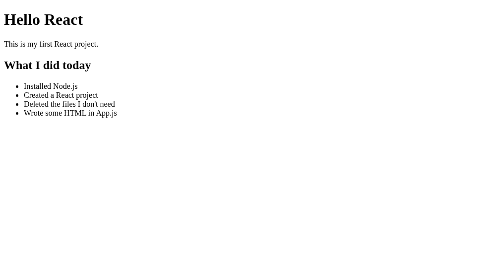

# React Task 1

My first React project (DEPI React track).

Live demo: https://depi-react-tasks.github.io/react-task-1/

## What I did
1. Installed Node.js
2. Created a React project with create-react-app
3. Deleted the files I don't need (logo, App.css, reportWebVitals, setupTests...) and their import lines
4. Wrote some HTML code inside App.js

## App.js

## index.html

## index.js

## Result

## Note
The `docs` folder is the production build (`npm run build`), it is used for GitHub Pages.
